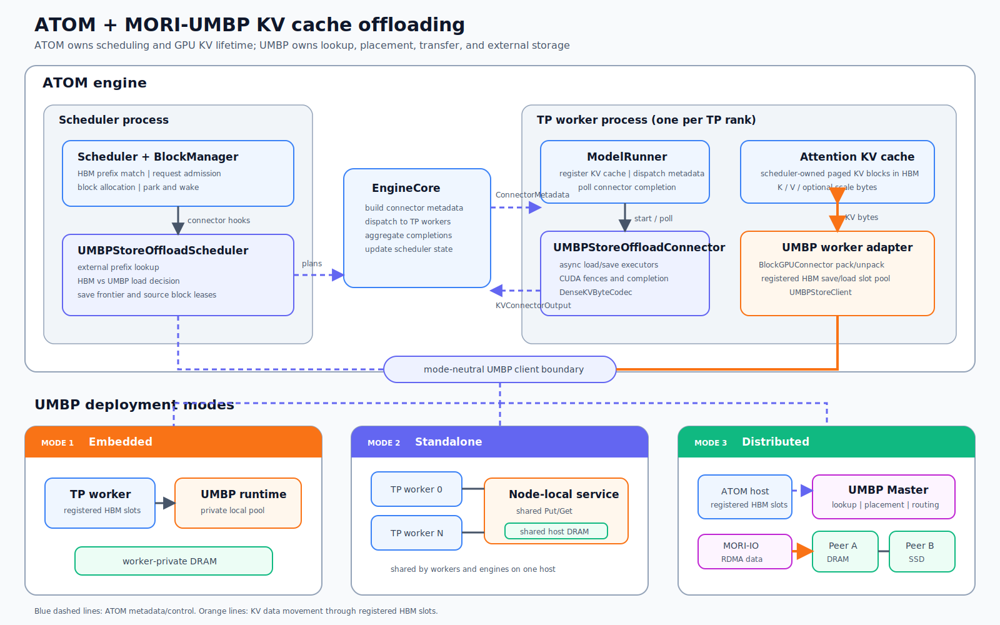

# [RFC] Add MORI-UMBP KV Cache Offloading for ATOM

## Motivation

ATOM's HBM prefix cache provides the fastest KV reuse path, but its capacity is bounded by accelerator memory. Long-context, agentic, and multi-turn workloads can retain much more reusable KV than fits in HBM. Once a prefix is evicted, ATOM has to recompute it even when the same content was recently produced by another request, DP rank, engine, or node.

MORI-UMBP is designed for this gap rather than as a simple CPU copy buffer. Its capabilities make it a useful external KV tier for ATOM:

1. **Unified tiered capacity.** MORI describes UMBP as a unified memory and bandwidth pool with distributed key-value access. Its public tier model covers HBM, host DRAM, and SSD. ATOM can keep one logical KV object while UMBP policy selects the storage tier.

2. **Shared and distributed ownership.** A UMBP Master tracks placement and can identify which nodes hold requested blocks. Prefixes can therefore outlive one worker's HBM allocation and be reused across workers, engines, and hosts.

3. **Separate control and data planes.** Master-side APIs handle registration, placement, reporting, and lookup. Hot Put/Get operations use the UMBP data plane backed by `DistributedClient`, `PoolClient`, and MORI-IO. This matches ATOM's scheduler/worker process split.

4. **GPU and RDMA integration.** MORI is built around modular RDMA and GPU communication. ATOM can register bounded HBM transfer pools and let MORI-IO move packed KV directly between those slots and UMBP storage, avoiding another connector-owned host copy.

5. **Placement and promotion below the engine.** UMBP supports named HBM/DRAM/SSD backends, capacity-aware placement, requester affinity, local/remote Get strategies, and promotion. These policies can evolve without adding medium-specific branches to ATOM's scheduler.

6. **Multiple visibility scopes behind one client contract.** UMBP can be worker-private, node-shared, or distributed across hosts. ATOM can start with a local deployment and retain the same connector lifecycle as the storage service expands.

The goal is not to load every external hit. For a short prefix, recomputation can still be cheaper than transfer. ATOM already has the right decision points: the real post-allocation HBM hit, chunk alignment, and `OFFLOAD_MIN_LOAD_TOKENS`. UMBP adds capacity and sharing; ATOM continues to decide whether a particular hit is worth using.

Primary capability references:

- [ROCm MORI project](https://github.com/ROCm/mori)
- [UMBP control- and data-plane overview](https://rocm.github.io/mori/api/umbp.html)
- [UMBP distributed tier-management benchmark](https://rocm.github.io/mori/UMBP-TIER-MANAGEMENT-BENCHMARK.html)

## Summary

This RFC proposes a native ATOM offload connector named `umbp_store`.

The design keeps ATOM's HBM prefix cache as L1 and adds UMBP as an external L2/L3 tier. It reuses ATOM's existing chunked-offload lifecycle rather than adding UMBP-specific behavior to `Scheduler`, `ModelRunner`, or model code.

The connector has two halves:

- a scheduler-side component that performs prefix lookup, decides whether an external hit is worth loading, and manages request/block lifetime;
- a worker-side component that packs KV, submits UMBP Put/Get operations, and reports completion.

The initial data path uses a bounded UMBP-registered HBM slot pool:

- save: pack ATOM KV blocks into save slots, then Put to UMBP;
- load: Get from UMBP into load slots, then unpack into ATOM KV blocks.

The model's live KV pool is not directly registered with UMBP in the first version. This limits the memory-lifetime and cancellation surface while preserving a future direct-range optimization.

Phase 1 targets dense PAGE-only MHA/MLA, DCP size 1, bulk all-layer transfer, and chunk-aligned objects. Stateful PAGE+STATE layouts, direct ranged I/O against live KV pages, and layer-wise load/compute overlap are follow-up work.

## Architecture Design

### High-level structure

The integration keeps ATOM's existing control/data split:

- **ATOM scheduler side:** external-prefix lookup, HBM-versus-UMBP decision, request parking, save tracking, and GPU block lifetime;
- **ATOM worker side:** KV packing/unpacking, HBM transfer-slot ownership, UMBP data movement, and completion reporting;
- **UMBP:** object placement, tier selection, routing, publication, and storage lifetime.

`KVConnectorFactory` creates `UMBPStoreOffloadScheduler` in the scheduler process and `UMBPStoreOffloadConnector` in every TP worker. Both use the same connector metadata and object namespace regardless of the selected UMBP mode.

The ATOM integration points are explicit: `Scheduler` and `BlockManager` call the scheduler-side connector hooks; `EngineCore` transports connector metadata to TP workers and aggregates their completion reports; `ModelRunner` registers the attention KV cache and invokes the worker-side connector; the worker adapter packs between the attention KV cache and its registered HBM slot pool before calling UMBP. The attention implementation does not call UMBP directly.

The scheduler component builds on ATOM's shared chunked-offload policy. The worker component builds on the dense offload path and reuses ATOM's opaque-byte KV codec and GPU pack/unpack implementation.

### Deployment modes

The modes differ by storage ownership and visibility, not by ATOM connector behavior:

| Mode | Ownership and visibility | Intended use |
| --- | --- | --- |
| `embedded` | Worker-private UMBP pool | Bring-up and private local caching |
| `standalone` | Node-local service shared by workers and engines | Shared cache within one host and warm engine restarts |
| `distributed` | Master-coordinated storage peers across hosts | Cluster capacity and cross-node prefix reuse |

DRAM and SSD are UMBP tier-policy choices. They do not create additional ATOM connector modes.

### Initial scope

This RFC covers the complete connector shape across embedded, standalone, and distributed UMBP deployments. Delivery can be incremental, but each phase must preserve the same scheduler/worker boundary, metadata model, and packed KV representation.

The initial implementation scope includes:

- **Model layouts:** dense PAGE-only MHA/GQA and dense MLA models whose complete reusable state is represented by the KV cache handled by `DenseKVByteCodec`.
- **KV formats:** BF16 first, followed by FP8 with K/V scale bytes included in the round trip. Restored bytes must be identical to the bytes originally written by the attention backend.
- **Cache granularity:** full, chunk-aligned prompt prefixes built from ATOM scheduler blocks. Partial trailing chunks are recomputed rather than persisted.
- **Parallelism:** TP is required in the initial supported topology, including TP size greater than 1. Each TP rank stores its own KV shard, lookup uses the shortest contiguous prefix available on every rank, and a load becomes visible only after all ranks complete successfully. PP size 1 and DCP/PCP size 1 remain the initial constraints; replicated-TP key deduplication is a later optimization.
- **Cache behavior:** HBM remains the preferred L1. UMBP supplies only the prefix beyond the admitted HBM hit, and failed or uneconomic loads fall back to normal prefill.
- **Transfer behavior:** asynchronous bulk save/load through registered HBM slots, with bounded in-flight memory and request-level completion. Per-layer readiness is not required initially.
- **Deployment:** embedded mode validates the connector locally; standalone mode adds a cache shared by workers and engines on one host; distributed mode adds Master-coordinated cross-node reuse over MORI-IO.
- **Storage tiers:** DRAM is the baseline tier. SSD placement and promotion are enabled through UMBP policy once distributed correctness and publication semantics are validated.
- **Composition:** `umbp_store` can run as the engine's only KV connector or as the offload member of `MultiConnector` beside an existing P/D transfer connector.

The architecture intentionally leaves room for stateful PAGE+STATE models, replicated-TP writer election, direct live-KV registration, and layer-wise transfer/compute overlap. These extensions require additional layout or lifetime contracts, but do not require a different top-level connector design.

## References

- [ROCm MORI](https://github.com/ROCm/mori)
- [UMBP API documentation](https://rocm.github.io/mori/api/umbp.html)
- [UMBP distributed tier-management benchmark](https://rocm.github.io/mori/UMBP-TIER-MANAGEMENT-BENCHMARK.html)
- `atom/kv_transfer/offload/chunked_scheduler.py`
- `atom/kv_transfer/offload/dense/connector.py`
- `atom/kv_transfer/offload/dense/kv_byte_codec.py`
- `atom/kv_transfer/offload/_block_gpu_connector.py`
